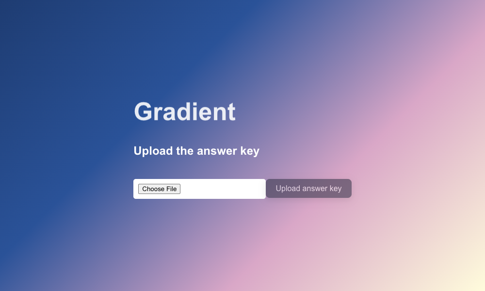

# Gradient

A grading assistant we started at **HackOHI/O 2024** (Ohio State's hackathon). The idea: a teacher
uploads an answer key, then uploads students' handwritten work as PDFs, and an AI model grades each
submission against the key.



## What works and what doesn't

This is a hackathon prototype, and I want to be clear about where it stopped.

- **Works:** the React app walks through the two upload steps, and the Express server stores an
  uploaded answer key on disk and records it in MongoDB.
- **Not built:** grading. The student-upload step reaches the server, which answers that grading is
  not built yet. The AI grading (we planned to use Google's Gemini) never made it past the plan.

## Run it

You need Node.js 20+ and a MongoDB database (a free MongoDB Atlas cluster works).

```sh
cd react
npm install
cp .env.example .env      # then paste your MongoDB connection string into MONGO_URI
npm run server            # API on http://localhost:5050
npm run dev               # app on http://localhost:5173, in a second terminal
```

## How it's put together

```text
react/
  src/App.jsx              the two upload steps
  src/components/          file picker, loading and message views
  src/utils/api.js         calls to the API (Vite forwards them to the server in development)
  server/index.js          Express API: stores answer keys, MongoDB connection
```

## Team

Built at HackOHI/O 2024 by [Yakob Getu](https://github.com/ygetu22), [maalin2](https://github.com/maalin2)
and [ghosh279](https://github.com/ghosh279). In November 2026 I cleaned up the code with help from Claude:
the server moved out of the React source, a bug that uploaded every answer key twice was fixed, and the
README now says honestly what was finished.
